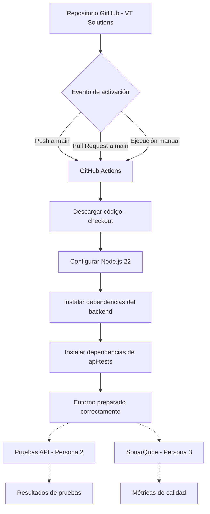

# Diagrama del Pipeline CI/CD - VT Solutions

## Flujo de Integración Continua

## Estado de implementación

### Etapas implementadas y verificadas
- Activación automática mediante push y pull request a main.
- Ejecución manual mediante workflow_dispatch.
- Descarga del repositorio con actions/checkout@v5.
- Configuración de Node.js 22 con actions/setup-node@v5.
- Instalación de dependencias del backend mediante npm ci.
- Instalación de dependencias de api-tests mediante npm ci.
- Ejecución exitosa del workflow en GitHub Actions.

### Etapas pendientes de integración
- Persona 2: ejecución automatizada de pruebas API con Jest y Axios.
- Persona 3: integración de SonarQube y análisis estático del código.

## Interpretación del diagrama

Las líneas continuas representan las etapas implementadas y verificadas.

Las líneas discontinuas representan las integraciones pendientes, que completarán el pipeline del Caso de Estudio #3.
