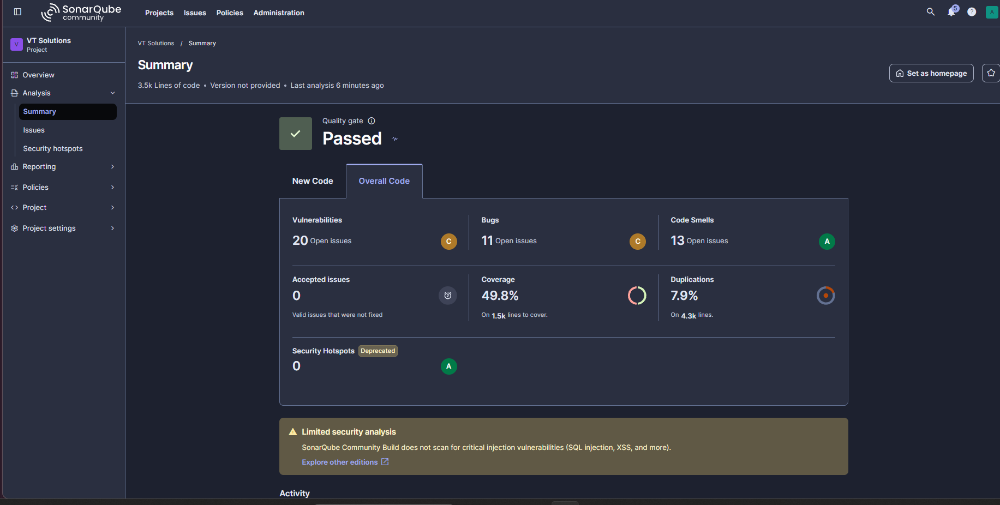
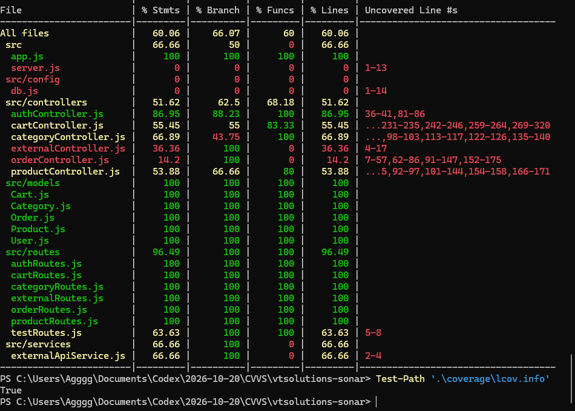
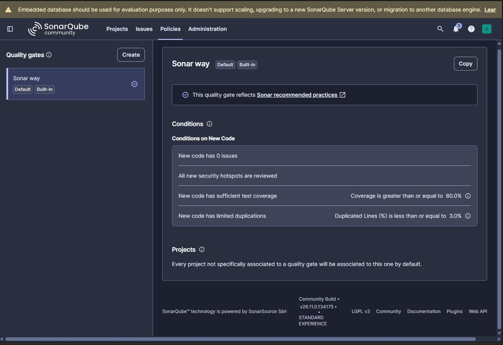
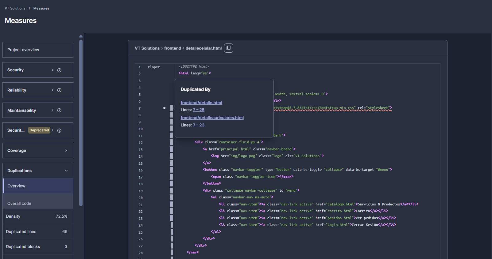

# Análisis estático e integración continua de VT Solutions

Universidad CENFOTEC · Caso de Estudio 3 · Persona 3 · 11 de noviembre de 2026

## Objetivo y alcance

Se configuró SonarQube Community Build para analizar el código de VT Solutions y comunicar su Quality Gate al pipeline de GitHub Actions. La implementación genera cobertura del backend durante las pruebas API y entrega el reporte LCOV al scanner. La validación comprende la ejecución local, el análisis remoto a través de un túnel HTTPS y la propagación de fallos en el pipeline.

El análisis estático examina el código mediante reglas para detectar patrones que afectan su seguridad, fiabilidad y mantenibilidad. SonarQube reúne esos hallazgos, las métricas y el Quality Gate en un panel de seguimiento. El alcance de Persona 3 comprende la configuración de SonarQube, la conexión con CI, la interpretación de los hallazgos y la documentación. Se reutilizó el ejecutor de pruebas API del equipo. El pipeline y la configuración de pruebas existentes constituyen las dependencias de trabajo con las Personas 1 y 2.

## Herramientas y preparación

| Elemento | Configuración verificada |
|---|---|
| Servidor de análisis | SonarQube Community Build 26.11.0.134175 para Windows |
| Java del servidor | Microsoft OpenJDK 21.0.13 |
| Scanner | SonarScanner CLI 8.0.1.6346 |
| Repositorio de trabajo | pagina-web-vtsolutions-main; cambios de caso3-sonarqube integrados en main mediante el PR #2 |
| Ejecución CI | GitHub Actions en Ubuntu 22.04 y Node.js 22 |
| Cobertura | c8 12.0.0, reporte LCOV del backend |
| Base de pruebas CI | MongoDB 8.0 local al ejecutor |
| Conexión remota | Quick Tunnel de Cloudflare hacia 127.0.0.1 puerto 9000 |

Se eligió la instalación de Windows después de observar demoras y fallos de respuesta de Docker Desktop y WSL en la computadora disponible. Java se instaló en una carpeta de herramientas del caso y se selecciona al iniciar SonarQube. La base H2 integrada conserva el estado del laboratorio académico. Los datos del contenedor utilizado inicialmente se conservaron.

El proyecto privado se identifica con la clave vt-solutions. El archivo sonar-project.properties define backend/src y frontend como fuentes y api-tests/tests como pruebas. Se excluyen dependencias, cobertura, directorios de distribución e imágenes del análisis de fuentes. El reporte se importa mediante sonar.javascript.lcov.reportPaths=coverage/lcov.info. Los secretos de autenticación están en GitHub Actions y se proporcionan al scanner durante su ejecución.

## Procedimiento de pruebas y cobertura

El ejecutor api-tests/scripts/run-entrega.js abre MongoDB en el puerto local 27017, crea una base con nombre aleatorio e inicia la aplicación en 127.0.0.1 puerto 4001. Después lanza Jest con la configuración de entrega. Al finalizar, cierra la API, elimina la base temporal y registra la comprobación de limpieza.

c8 envuelve el proceso Node.js que carga la aplicación. Esto permite medir los controladores, modelos y rutas que atienden las peticiones de las pruebas API. Se utiliza la opción --all para incluir archivos del backend que permanecen sin ejecutar. Los archivos del frontend forman parte del análisis estático y quedan pendientes de pruebas de interfaz que aporten su propia cobertura.

La ejecución local comprobó cuatro suites y treinta pruebas correctas. El reporte de c8 registró 60,06 % de líneas y sentencias, 66,07 % de ramas y 60 % de funciones para el backend. Los archivos sonar-cobertura.json y sonar-cobertura-entorno.json conservan el resultado y la eliminación de la base temporal.

## Flujo de integración continua

El workflow se activa con cambios en main, pull requests hacia main y ejecuciones manuales. La secuencia descarga el repositorio con su historial, configura Node.js, instala las dependencias con npm ci, ejecuta las pruebas con c8, instala el scanner, publica el informe y espera el Quality Gate. Las evidencias se guardan como artefactos durante catorce días, incluso cuando falla una etapa previa.

SonarQube Community Build trabaja con una sola rama de análisis. Para verificar las instantáneas de los cambios del equipo se invoca el scanner en modo de proyecto único y se registra el SHA comprobado. Las ejecuciones se serializan mediante un grupo de concurrencia. El panel de SonarQube representa la última instantánea publicada. Los checks de GitHub y sus artefactos mantienen la trazabilidad de cada ejecución. Esta configuración requiere coordinar los análisis locales con los del pipeline.

El scanner recibe sonar.qualitygate.wait=true y un tiempo máximo de espera de 300 segundos. Un Quality Gate fallido produce un código de salida distinto de cero y provoca el fallo del job. Una prueba API fallida detiene la secuencia antes del análisis de SonarQube. Los pull requests externos requieren una rama del repositorio para disponer del secreto de análisis que GitHub restringe en eventos de forks.

## Resultados del análisis local de referencia

| Indicador | Resultado |
|---|---|
| Líneas de código sin comentarios | 3548 |
| Vulnerabilidades | 20 |
| Bugs | 11 |
| Code smells | 13 |
| Cobertura global de SonarQube | 49,8 % |
| Cobertura de líneas en SonarQube | 48,6 % |
| Cobertura de condiciones en SonarQube | 66,1 % |
| Líneas susceptibles de cobertura | 1534 |
| Duplicación global | 7,9 % |
| Security Hotspots registrados | 0 |
| Quality Gate | Passed |

Estos valores proceden de las capturas y de la consulta de métricas del proyecto conservada en metricas-locales.json. La primera ejecución mostró 0 % de cobertura. La segunda incorporó el reporte LCOV y actualizó la cobertura global a 49,8 %. c8 y SonarQube utilizan ámbitos y cálculos diferentes. SonarQube incorpora líneas y condiciones del código analizado, mientras que la tabla de c8 corresponde al backend.

El gate Sonar way exige cero incidencias nuevas, revisión de los Security Hotspots nuevos, al menos 80 % de cobertura de código nuevo y un máximo de 3 % de duplicación nueva. La primera ejecución estableció la referencia de la rama. La consulta conservada después del segundo análisis registró cero incidencias nuevas y estado OK. Las métricas globales documentan deuda y problemas existentes que deben priorizarse por su impacto.

## Hallazgos e interpretación

### Configuración CORS

La regla javascript:S5122 señaló app.use(cors()) en backend/src/app.js, línea 14, con clasificación Vulnerability y severidad Major. La configuración predeterminada utiliza Access-Control-Allow-Origin con valor *. El impacto depende de los datos expuestos y de los controles de autenticación de cada endpoint. Se recomienda definir los orígenes autorizados del frontend por entorno y revisar el acceso requerido por las rutas.

### Etiqueta del campo de correo

La regla Web:InputWithoutLabelCheck señaló frontend/Registro.html, línea 48, como Bug Major. El campo correo tiene id, y la etiqueta contigua requiere la asociación for="correo". Esta relación permite anunciar el nombre del control a los usuarios de tecnologías de asistencia y activar el campo al pulsar la etiqueta.

### Etiqueta del campo de contraseña

La regla Web:S6853 señaló la etiqueta de contraseña de frontend/Registro.html, línea 56, como Code smell Major. Se propone asociarla mediante for="password" al control existente. La incidencia comparte una causa de accesibilidad con el hallazgo del correo. Las categorías del informe corresponden a la clasificación que mostró SonarQube en Standard Experience.

### Duplicación en páginas de producto

frontend/detallecelular.html mostró 72,5 % de duplicación, 66 líneas duplicadas y tres bloques. El bloque revisado coincide con frontend/detalle.html, líneas 7 a 25, y frontend/detalleauriculares.html, líneas 7 a 23. La estructura compartida incluye navegación. Se recomienda centralizarla en una plantilla o componente reutilizable para reducir el mantenimiento de copias.

La priorización propuesta comienza por validar el alcance de seguridad de CORS, continúa con las asociaciones de etiquetas de los formularios y después aborda la estructura duplicada. Las correcciones se incorporarán con revisión del equipo y nuevas ejecuciones que permitan comparar sus efectos.

## Verificación remota y evidencias

| Comprobación | Evidencia |
|---|---|
| Pruebas y análisis remoto correctos | ejecución 42973658804, intento 3 |
| Prueba fallida detiene el pipeline | ejecución 42974143141 |
| Cobertura importada | LCOV y registros del scanner en el artefacto de la ejecución normal |
| Informe procesado | report-task.txt y Quality Gate devuelto por el servidor |

[Ejecución normal de GitHub Actions, intento 3](https://github.com/rodrylms14/pagina-web-vtsolutions-main/actions/runs/42973658804/attempts/3)

[Ejecución con fallo controlado de prueba](https://github.com/rodrylms14/pagina-web-vtsolutions-main/actions/runs/42974143141)

La demostración de fallo de pruebas reutiliza el parámetro fallo_controlado del equipo. Pasaron las treinta pruebas originales y fallaron cuatro aserciones de demostración, una por suite. El registro de entorno comprobó la limpieza de la base aun en ese caso. Los artefactos descargados se conservan bajo docs/evidencias/caso3.

También se comprobó un Quality Gate fallido en una rama de demostración. Se agregó un formulario con una etiqueta sin asociación, se mantuvieron las pruebas API correctas y SonarQube rechazó las incidencias nuevas. La ejecución 42975017694 terminó en fallo en el paso del scanner. El archivo de demostración queda fuera de la rama de entrega.

[Ejecución con Quality Gate fallido](https://github.com/rodrylms14/pagina-web-vtsolutions-main/actions/runs/42975017694)

## Integración en main y protección de la rama

La implementación se integró en main mediante el [PR #2](https://github.com/rodrylms14/pagina-web-vtsolutions-main/pull/2), fusionado el 11 de noviembre de 2026. El commit de integración es `262645e47b9859bca3ed9a06edb23986e974eefe`. Antes de la integración, la [comprobación del último commit de entrega](https://github.com/rodrylms14/pagina-web-vtsolutions-main/actions/runs/42975697289) terminó correctamente.

La comprobación Pruebas API y SonarQube puede exigirse para futuras integraciones. Durante la preparación se encontró main sin protección y la cuenta colaboradora carecía del permiso administrativo para activarla. El archivo [proteccion-main.json](proteccion-main.json) contiene la configuración preparada; su aplicación corresponde al propietario. La fusión del PR no confirma por sí misma que la protección esté activada.

## Continuidad y limitaciones

El túnel mantiene una dirección HTTPS temporal que cambia al crear una conexión nueva. La computadora, SonarQube y cloudflared deben estar activos durante los análisis. El script local preparar-demostracion.ps1 comprueba los servicios y actualiza SONAR_HOST_URL en GitHub. El token del proyecto debe mantenerse vigente en SONAR_TOKEN.

La base H2 se utiliza para la evaluación académica. El panel de Community Build advierte que el análisis de seguridad de esta edición es limitado. También se observaron advertencias de espacio libre en C. La comprobación de arranque exige alrededor de 23,8 GiB disponibles y se registraron aproximadamente 21,05 GiB. Se requiere liberar al menos 3 GiB antes de reiniciar el servidor.

La cobertura refleja las rutas ejercitadas por las pruebas disponibles. La lectura de un archivo o la ejecución de una definición de modelo puede producir cobertura de líneas elevada y requiere interpretación junto con las aserciones. La ejecución de pruebas de interfaz y la ampliación de pruebas para pedidos y errores del backend permitirían medir más comportamiento de la aplicación.

## Conclusiones y recomendaciones

La implementación relaciona las pruebas API, un reporte de cobertura verificable y los resultados del análisis estático con el estado de GitHub Actions. Las evidencias permiten reproducir el procedimiento y explicar los hallazgos de seguridad, accesibilidad y duplicación. El resultado local de referencia registra 49,8 % de cobertura global y cuarenta y cuatro incidencias abiertas.

Se recomienda priorizar los hallazgos por impacto, mantener las credenciales como secretos de GitHub, conservar la trazabilidad mediante commits y artefactos y activar la protección de main con ayuda del propietario. Para una operación sostenida conviene evaluar un servidor con almacenamiento suficiente y una dirección de red estable.

## Referencias

- Universidad CENFOTEC. Enunciado del Caso de Estudio 3 del curso Calidad Verificación y Validación de Software. Documento suministrado por el equipo.
- [SonarSource. Integración de Community Build con GitHub Actions](https://docs.sonarsource.com/sonarqube-community-build/devops-platform-integration/github-integration/adding-analysis-to-github-actions-workflow)
- [SonarSource. Cobertura de JavaScript y TypeScript](https://docs.sonarsource.com/sonarqube-community-build/analyzing-source-code/test-coverage/javascript-typescript-test-coverage)
- [SonarSource. Requisitos del servidor](https://docs.sonarsource.com/sonarqube-community-build/server-installation/server-host-requirements)
- [c8. Cobertura nativa de V8 y generación de reportes](https://github.com/bcoe/c8)
- [Express. Middleware CORS](https://expressjs.com/en/resources/middleware/cors/)
- [MDN. Asociación de etiquetas HTML](https://developer.mozilla.org/en-US/docs/Web/HTML/Reference/Elements/label)
- [Cloudflare. Túneles temporales](https://developers.cloudflare.com/tunnel/get-started/quick-tunnels/)

## Evidencias gráficas

